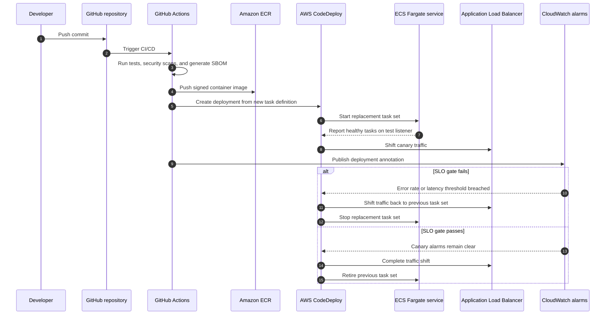
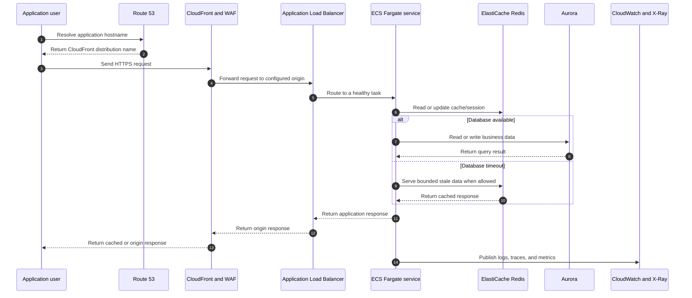

# AWS ECS Fargate HA - Runtime + Deployment Sequence

## Deployment flow

## Request flow

## Staff Interview Angles

- Explain ECS deployment safety using task sets and metric gates.
- Discuss degraded-read path to preserve availability during DB stress.
- Mention cost/performance trade-off versus EKS operational flexibility.
