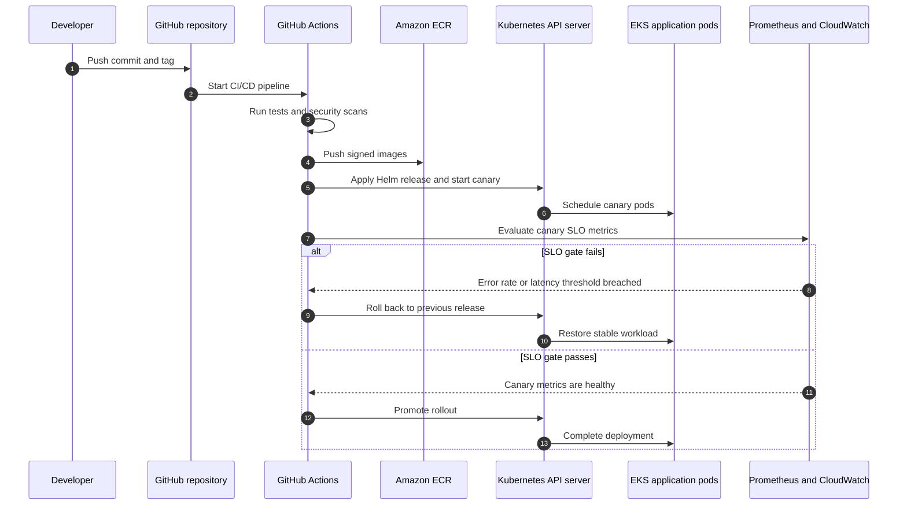
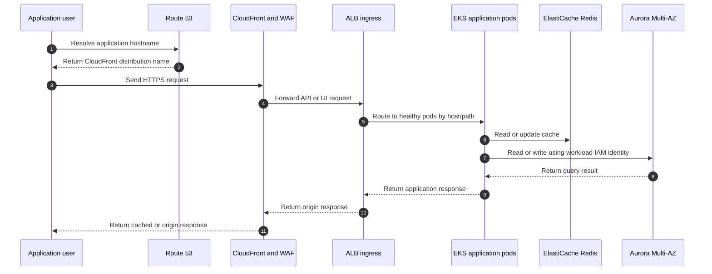
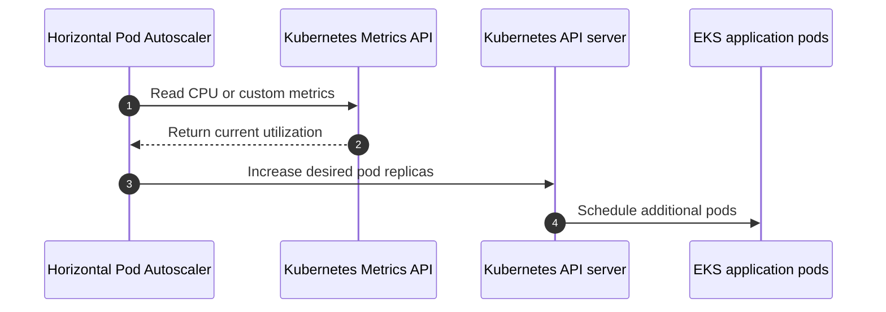

# AWS EKS Multi-AZ - Runtime + Deployment Sequence

## Deployment flow

## Request flow

## Autoscaling flow

## Staff Interview Angles

- Explain why rollout gates use SLO metrics, not only pod health.
- Call out blast-radius control via canary + automated rollback.
- Mention scale loop: queue depth/RPS -> autoscaling -> cost/latency trade-off.
