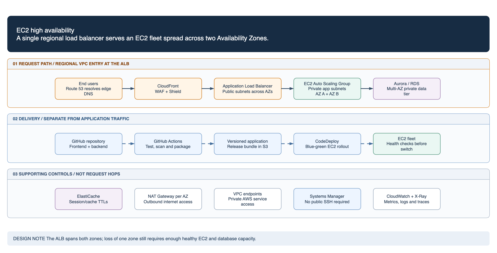

# AWS EC2 High Availability

Purpose: explain a multi-AZ web application, its deployment path, and private
data tier. The original editable diagram is [aws-ec2-ha.drawio](./aws-ec2-ha.drawio).

## Design notes

- The ALB spans public subnets in multiple Availability Zones; it is one
  regional load balancer, not one ALB per subnet.
- Keep application instances private. Use Systems Manager for administration
  instead of exposing a public SSH bastion where possible.
- Use NAT per AZ for general outbound access; use VPC endpoints for supported
  AWS services. Route security-sensitive egress through an approved firewall.
- Aurora/RDS Multi-AZ improves availability within a Region. It is not, by
  itself, a cross-Region disaster-recovery design.
- Treat Redis as a cache/session layer with bounded key growth and TTLs, not
  as the system of record.
