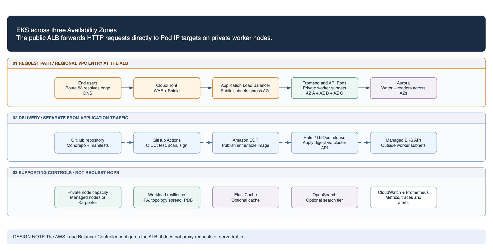

# AWS EKS Multi-AZ

Purpose: show an EKS application split across edge, cluster, data, and
delivery concerns. The editable diagram is
[aws-eks-multi-az.drawio](./aws-eks-multi-az.drawio).

## Design notes

- Keep nodes spread across AZs. Use requests, limits, topology spread,
  PodDisruptionBudgets, and autoscaling together; none is a substitute for
  enough failure headroom.
- The EKS control plane is AWS-managed. Restrict API endpoint access and
  separate control-plane access from application traffic.
- Prefer the AWS Load Balancer Controller for ALB integration. Treat a
  service mesh as optional and justify its operational cost.
- Use an image digest or registry-enforced immutable tag in the release
  configuration. CI should build and test before publishing or promotion.
- Aurora Multi-AZ, Redis, and OpenSearch have different data and recovery
  semantics; define backups, retention, and restore tests per service.
