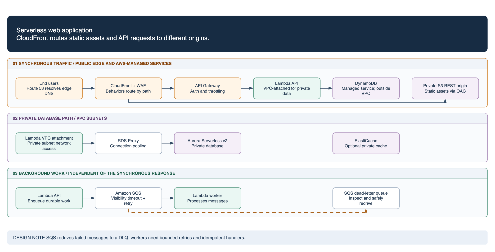

# AWS Serverless Web Application

Purpose: show a static frontend, API, asynchronous work, and private data
services. The editable diagram is
[aws-serverless-lambda.drawio](./aws-serverless-lambda.drawio).

## Design notes

- CloudFront serves static assets from a private S3 origin; do not expose the
  bucket publicly just to host a website.
- Put Lambda functions in a VPC only when they need private resources.
  VPC attachment does not automatically provide internet access.
- Use RDS Proxy and bound Lambda concurrency to protect relational database
  connection capacity during bursts.
- Use SQS for durable asynchronous work, with bounded retries, idempotent
  handlers, and DLQ redrive controls.
- Provisioned Concurrency can reduce selected cold starts, but adds cost.
  Measure startup latency and user impact before enabling it broadly.
- Use DynamoDB Global Tables only when multi-Region replication and conflict
  semantics match the workload; PITR alone is not regional failover.
