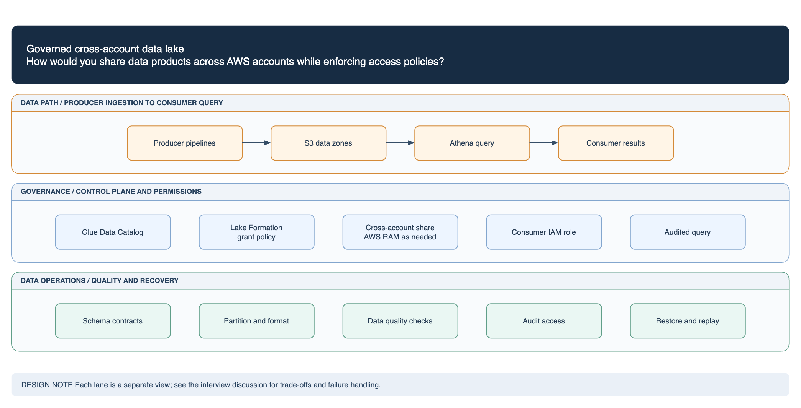

# Governed cross-account data lake

**Interview question:** How would you share data products across AWS accounts
while enforcing access policies?

[Editable diagram](./aws-governed-data-lake.drawio)
Difficulty: Advanced

## Expert discussion

### Architecture

Separate producer-owned S3 data and catalog metadata from consumer query
workloads. Register relevant locations, catalog the tables, grant Lake
Formation permissions, and configure cross-account sharing and resource links
as required by the chosen version and topology.

### Design considerations

IAM, S3, KMS and Lake Formation policies have distinct roles. A catalog grant
does not automatically satisfy every S3, KMS and query-engine permission. Test
effective access with the actual consumer role.

### Trade-offs and operations

Use supported engines for row, column or cell filtering and validate its
limitations; do not assume all S3 readers are subject to table-level filters.
Use separate accounts, encryption and data ownership boundaries where needed.

### Validation

Select partitioning and formats based on measured query patterns. Monitor
ingestion lag, quality failures, scan bytes, grant changes and query failures.
Test backup, revocation and data replay rather than assuming replication is a
backup.

## Interview follow-ups

**Q: Does a Lake Formation table grant replace every other permission?**

No. Test the actual identity against the relevant IAM, Lake Formation, KMS and
underlying service requirements. Cross-account resource links and AWS RAM
acceptance may also be necessary for the chosen setup.

**Q: How do you prevent consumers bypassing governance?**

Limit direct object access and key permissions, use supported governed query
integrations, and test a direct S3 read as well as a table query. Review
changes to data filters and audit logs.

## Sources

- <https://docs.aws.amazon.com/lake-formation/latest/dg/cross-account-permissions.html>
- <https://docs.aws.amazon.com/lake-formation/latest/dg/data-filtering.html>
