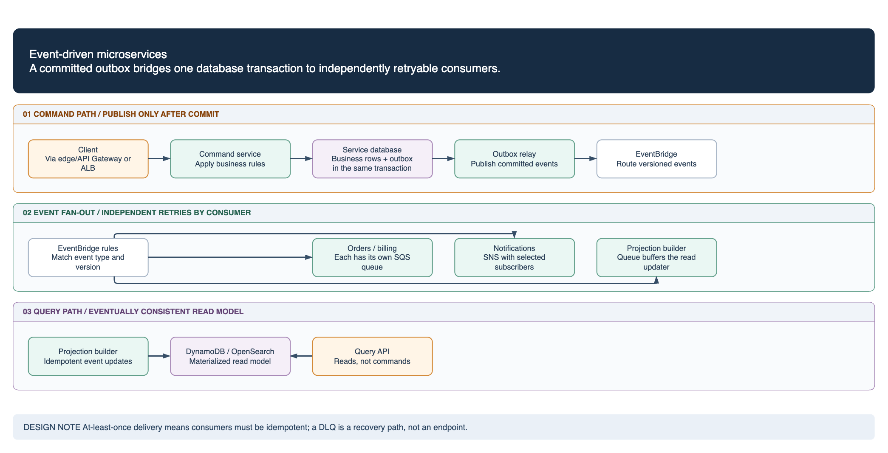

# AWS Event-Driven Microservices

Purpose: follow a command through durable event publication and independent
consumers. The editable diagram is
[aws-event-driven-microservices.drawio](./aws-event-driven-microservices.drawio).

## Design notes

- The outbox keeps the database update and event intent in one transaction;
  a relay publishes committed events later.
- Events are commonly delivered at least once. Consumers need idempotency;
  FIFO queues provide ordering only within their configured message groups.
- Set bounded retries, visibility timeouts, and DLQs. Replays need duplicate
  safety and an operator-owned procedure.
- Version event schemas compatibly. Contract tests should check producers and
  consumers before a rollout.
- The read model is eventually consistent. Do not present CQRS as a free
  performance gain when the product requires immediate read-after-write.
