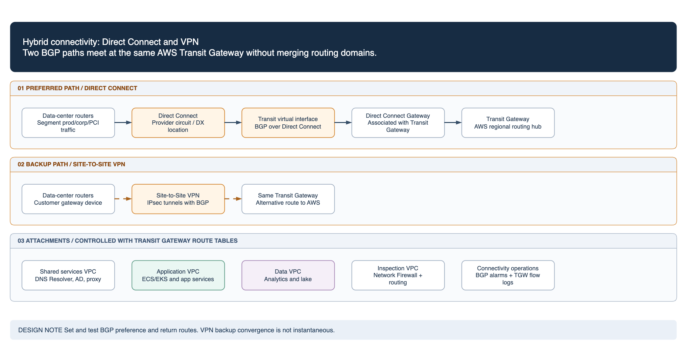

# AWS Hybrid Connectivity: Direct Connect and VPN

Purpose: show primary private connectivity, a VPN backup, segmentation, and
the shared AWS hub. The editable diagram is
[aws-hybrid-connectivity-dx-vpn.drawio](./aws-hybrid-connectivity-dx-vpn.drawio).

## Design notes

- Direct Connect and VPN are separate paths. Use BGP policy and tested route
  preference for failover; do not assume failover is instantaneous.
- Direct Connect Gateway and Transit Gateway attachment patterns depend on
  the selected virtual interface and routing design.
- Keep prod, corporate, and regulated routes segmented. Avoid unintended
  transitive paths and validate return routes to prevent asymmetric routing.
- Centralized inspection requires symmetric routing through the firewall.
  Test failure behavior as well as the healthy route.
- Monitor BGP state, tunnel health, packet loss, route changes, and synthetic
  application probes.
