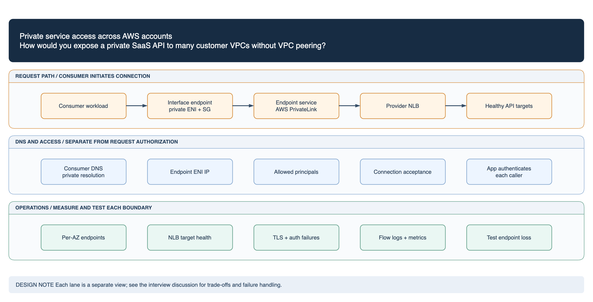

# Private service access across AWS accounts

**Interview question:** How would you expose a private SaaS API to many
customer VPCs without VPC peering?

[Editable diagram](./aws-privatelink-cross-account.drawio)
Difficulty: Advanced

## Expert discussion

### Architecture

An interface endpoint gives the consumer private IPs in selected subnets.
Requests reach a provider endpoint service backed by a Network Load Balancer.
The provider and consumer do not need VPC peering or non-overlapping CIDRs for
this connection.

### Design considerations

Limit allowed principals and, where appropriate, require acceptance. This
authorizes the connection, not every API call: enforce application
authentication, tenant authorization, TLS and audit independently. Verify
provider-owned private DNS before enabling it.

### Trade-offs and operations

PrivateLink is service-level access rather than general routed network
connectivity. Compare its per-endpoint/AZ cost and one-way initiation with
Transit Gateway or peering when the requirement is broader connectivity.

### Validation

Investigate private DNS resolution, endpoint security groups, connection
acceptance, enabled AZs and NLB target health. Test a zonal endpoint or target
failure; track connection errors, latency and per-AZ health.

## Interview follow-ups

**Q: How do you prevent one tenant accessing another tenant's data?**

Treat endpoint authorization as network admission, not tenant identity.
Authenticate the application request, derive tenant identity from a trusted
credential, authorize every resource, and test cross-tenant denial.

**Q: What happens when an Availability Zone fails?**

Provide endpoints and healthy targets in the required zones, understand the
chosen regional and cross-zone configuration, and test client DNS and
connection retry behavior. Do not assume a configured endpoint guarantees
healthy backend capacity.

## Sources

- <https://docs.aws.amazon.com/vpc/latest/privatelink/create-endpoint-service.html>
- <https://docs.aws.amazon.com/vpc/latest/privatelink/configure-endpoint-service.html>
