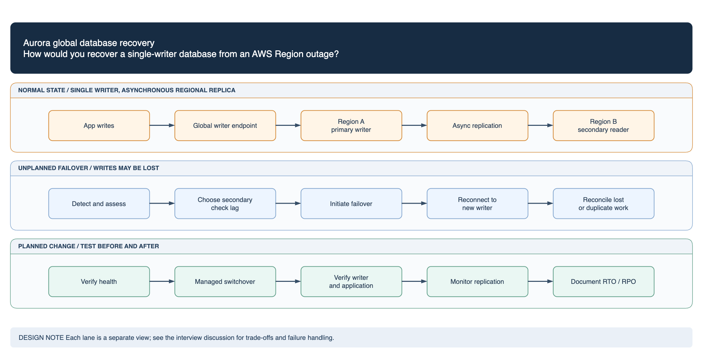

# Aurora global database recovery

**Interview question:** How would you recover a single-writer database from an
AWS Region outage?

[Editable diagram](./aws-aurora-global-disaster-recovery.drawio)
Difficulty: Advanced

## Expert discussion

### Architecture

Aurora Global Database has one primary write Region and asynchronously
replicated secondary clusters. Applications in the second Region need cross-
Region access to the primary for writes or an explicit read-only/degraded
behavior.

### Design considerations

For an unplanned outage choose a viable secondary and initiate managed
failover when supported. Writes not yet replicated may be lost: inspect lag,
reconcile external side effects, and do not claim zero RPO. Planned switchover
waits for synchronization and is a different operation.

### Trade-offs and operations

The global writer endpoint updates for supported managed failover/switchover.
Clients still need network reachability, DNS refresh and connection-pool retry
behavior; existing connections do not magically move. Test fencing and the
operational consequences of independent writes.

### Validation

Measure replication lag, data reconciliation counts, connection recovery, end-
to-end write correctness and actual RTO/RPO. Rebuild or rejoin the former
primary using the supported recovery process and rehearse controlled failback.

## Interview follow-ups

**Q: Can both Regions accept database writes?**

Not as independent Aurora Global Database primary writers. Route writes to the
active primary with viable cross-Region connectivity, or use a deliberate
read-only/degraded path until a secondary is promoted.

**Q: What proves the recovery objective is met?**

Measure detection, decision, promotion, DNS and client reconnection times
separately. Compare them with the RTO, compare lost replicated work with the
RPO, and reconcile external side effects before declaring recovery complete.

## Sources

- <https://docs.aws.amazon.com/AmazonRDS/latest/AuroraUserGuide/aurora-global-database-disaster-recovery.html>
- <https://docs.aws.amazon.com/AmazonRDS/latest/AuroraUserGuide/aurora-global-database-connecting.html>
