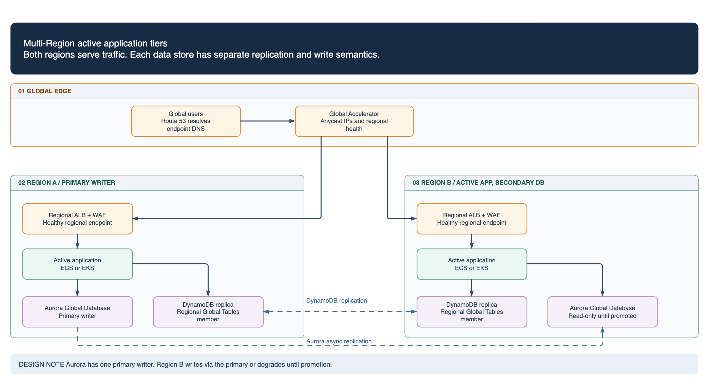

# AWS Multi-Region Services and Data

This diagram distinguishes active application tiers from data stores that
have different replication and write semantics. The editable diagram is
[aws-multi-region-active-active.drawio](./aws-multi-region-active-active.drawio).

## Design notes

- The application tier can serve in both Regions, but Aurora Global Database
  has a single primary writer. The secondary must be promoted for writes;
  this is not active-active Aurora writing.
- DynamoDB Global Tables replicate writes across Regions. Define conflict
  behavior, consistency expectations, and idempotent update patterns.
- S3 Cross-Region Replication is asynchronous. Define replication lag,
  versioning, deletion handling, and recovery expectations.
- A Global Accelerator or Route 53 health policy changes traffic routing;
  it does not promote databases or make state consistent.
- Test regional loss, traffic draining, database promotion, replay, and
  failback as separate runbook steps. Set measured RTO and RPO targets.
- AWS Global Endpoints can help route selected EventBridge traffic during a
  Regional impairment; queueing and consumer recovery remain application
  responsibilities.
