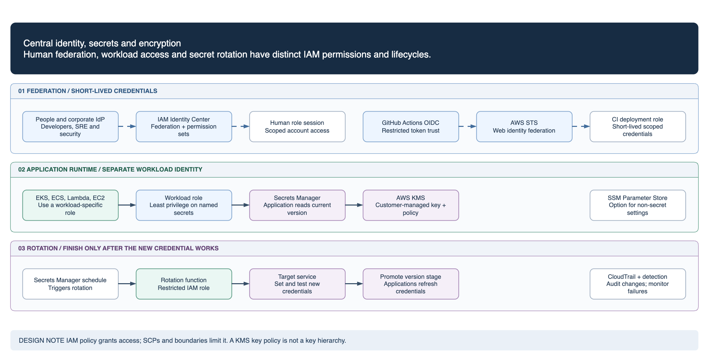

# AWS Identity, Secrets, and Encryption

Purpose: separate human federation, workload identity, authorization,
secret delivery, encryption, and audit. The editable diagram is
[aws-centralized-identity-secrets.drawio](./aws-centralized-identity-secrets.drawio).

## Design notes

- IAM Identity Center supports human access; applications use workload roles.
  Give each workload its own least-privilege identity and short-lived session.
- OIDC federation avoids storing long-lived AWS access keys in CI secrets.
  Validate issuer, audience, and repository/workflow claims in the trust
  policy.
- SCPs limit what accounts can do but do not grant permissions. IAM identity
  and resource policies still need explicit authorization.
- Store secret values in Secrets Manager. Use Parameter Store for
  non-sensitive configuration unless the selected tier and encryption
  controls explicitly meet the secret requirements.
- KMS keys are policy boundaries, not a parent-child key hierarchy. Use
  envelope encryption and service integrations; applications should not
  receive raw key material.
- Rotation must be coordinated with consumers. Verify both the new
  credential and rollback behavior before marking rotation complete.
