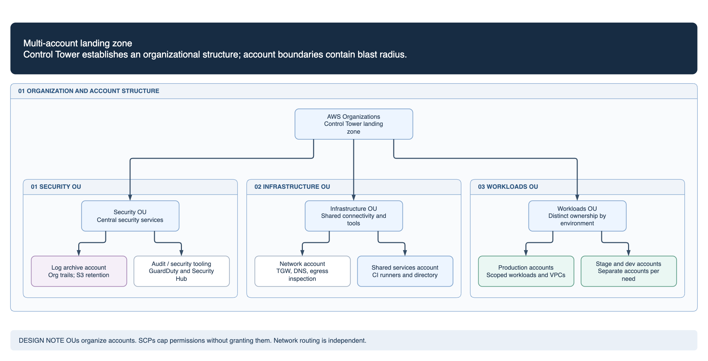

# AWS Multi-Account Landing Zone

Purpose: explain how organizational guardrails, security services, shared
networking, and workload accounts fit together. The editable diagram is
[aws-multi-account-landing-zone.drawio](./aws-multi-account-landing-zone.drawio).

## Design notes

- Separate accounts create ownership, cost-allocation, and blast-radius
  boundaries. OUs organize accounts; they are not network boundaries.
- SCPs set maximum permissions, not grants. IAM roles and resource policies
  still determine what a principal can do.
- Keep organization-level logs in a dedicated account with restrictive access,
  retention, and tamper-protection controls.
- Central networking reduces duplicated connectivity work, but routing,
  firewall policy, and account ownership must remain explicit.
- Use short-lived CI credentials through OIDC and scoped deployment roles.
  Avoid long-lived access keys in repositories.
