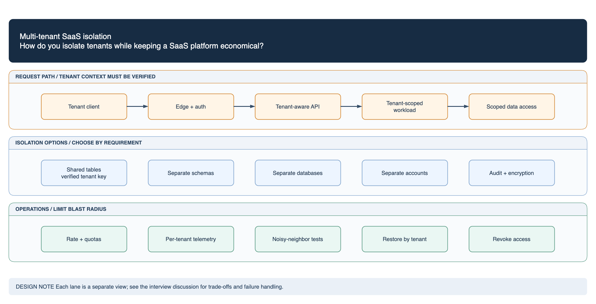

# Multi-tenant SaaS isolation

**Interview question:** How do you isolate tenants while keeping a SaaS
platform economical?

[Editable diagram](./aws-saas-tenant-isolation.drawio)
Difficulty: Advanced

## Expert discussion

### Architecture

Derive tenant identity from a validated credential or trusted server-side
mapping, not a client-supplied tenant ID. Carry it into authorization
decisions and every data/cache lookup.

### Design considerations

Pooled tables minimize cost but demand mandatory tenant-scoped queries and
controls; database-per-tenant or account-per-tenant increases isolation and
operational cost. Match the boundary to regulatory needs, scale, noisy-
neighbor risk and recovery requirements.

### Trade-offs and operations

Enforce least privilege and test negative access across API, background jobs,
object storage, caches and logs. Partition keys alone are not an authorization
system; tenant context must survive asynchronous workflows.

### Validation

Use per-tenant quotas, bounded retries and queue fairness. Test cross-tenant
access, credential revocation, tenant-specific restore, workload isolation and
the cost of onboarding thousands of tenants.

## Interview follow-ups

**Q: Can a tenant key in a table or cache enforce isolation on its own?**

No. Server-side authorization must bind a verified principal to the tenant and
constrain every query, object path, cache key and background job. Negative
tests must cover both reads and writes.

**Q: When do you choose a stronger isolation boundary?**

Use a dedicated database, account or deployment when compliance, restore
objectives or blast-radius requirements justify the added fleet-management
cost. Measure per-tenant load and operations effort.

## Sources

- <https://docs.aws.amazon.com/wellarchitected/latest/saas-lens/tenant-isolation.html>
