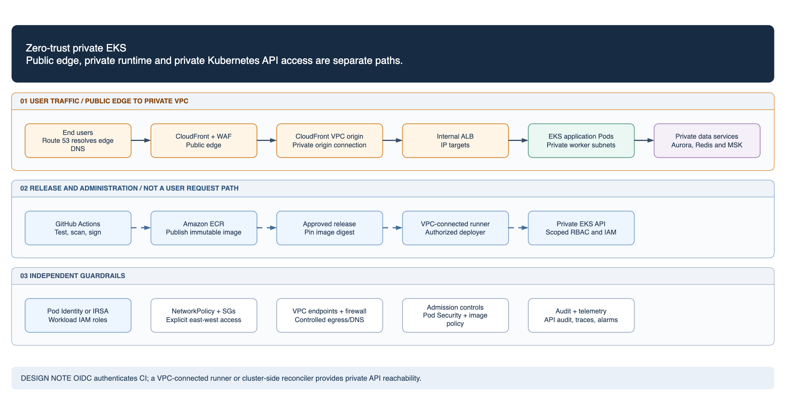

# AWS Zero-Trust Private EKS

Purpose: illustrate private cluster access, identity-first workloads,
controlled ingress, and explicit egress. The editable diagram is
[aws-zero-trust-private-eks.drawio](./aws-zero-trust-private-eks.drawio).

## Design notes

- CloudFront can use a supported private-origin pattern to reach internal
  ingress. Confirm the selected origin integration and regional constraints.
- Keep the Kubernetes API private or tightly restricted. CI needs an approved
  network path to it; an OIDC token alone does not provide network reachability.
- Use workload identity rather than static credentials in Pods. Apply
  least-privilege IAM and Kubernetes RBAC separately.
- Network policies, security groups, DNS controls, and firewalls govern
  different layers; test the complete path, including required egress.
- “Private” does not mean trusted. Authenticate and authorize users,
  services, and operators at every boundary.
