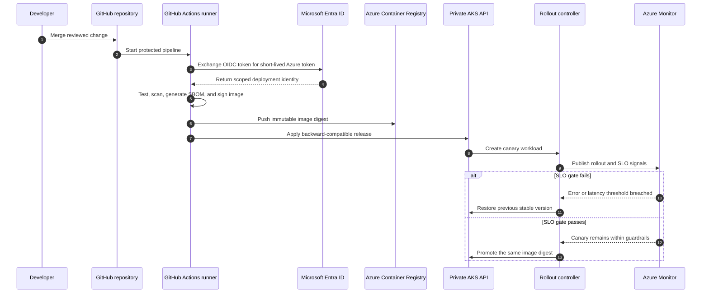
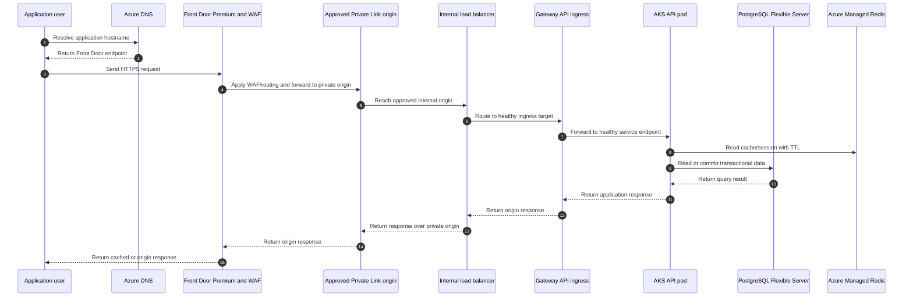
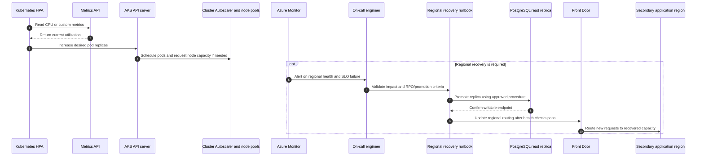

# Azure AKS Enterprise — Deployment, Request, and Recovery Flows

These sequences describe one reference design, not automatic Azure behavior. The AKS API is private, so the deployment runner needs network access to it. Front Door Private Link origins require an approved connection and supported origin configuration.

## Deployment flow

Use a VNet-connected runner for a private AKS API. Helm applies manifests; a rollout controller and metrics analysis provide canary behavior and automated rollback.

## Request flow

DNS returns the Front Door hostname; it does not forward the HTTP request. Redis is a cache, not the source of truth.

## Scale and regional recovery

PostgreSQL cross-Region replicas are asynchronous and do not promote themselves. Establish data promotion, connection changes, traffic shift, and failback ownership in advance.
