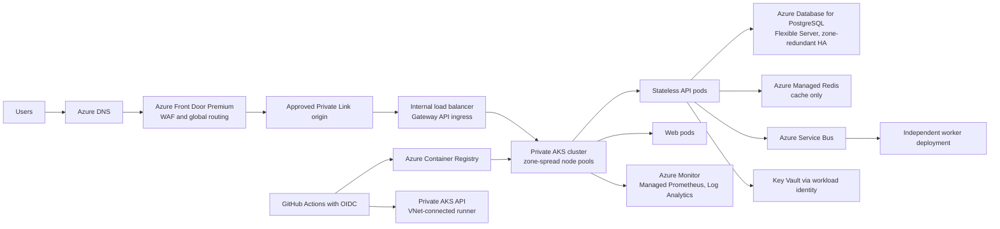

# Azure Cloud Architecture — Interview Guide

This is a production-oriented reference design for a multi-tenant web/API workload on AKS. It is a baseline to adapt, not a claim that AKS is the right answer for every workload.

## 1. Start With the Problem

Before drawing services, ask:

- Who are the users and tenants? What are the authorization and data-isolation boundaries?
- What are the peak/steady request rates, payload sizes, read/write mix, and growth assumptions?
- What are the latency SLOs, availability objective, RTO, and RPO?
- Which operations must be strongly consistent? Which data can be cached or replicated asynchronously?
- What are the data residency, encryption, audit, and retention requirements?
- Which teams operate the cluster, network, identity, database, and on-call response?

Separate hard constraints from preferences. An interviewer expects a design whose complexity follows the requirements.

## 2. Reference Architecture

The example assumes a regional AKS workload behind a global edge. A serverless or managed application platform may be simpler and cheaper if Kubernetes-specific controls are not required.

## 3. Request and Network Paths

### Inbound

1. Azure DNS resolves the application hostname to Azure Front Door; DNS resolution is not the HTTP request path.
2. Front Door Premium applies edge routing and WAF policy, then reaches a private origin over an approved Private Link connection.
3. An internal load balancer and a supported Gateway API implementation route to Kubernetes Services and healthy pods.
4. Configure origin restrictions so callers cannot bypass Front Door. Validate the Front Door identifier/host and health-probe behavior at the origin.

Front Door, Application Gateway, and Application Gateway for Containers are different products and are not interchangeable. Avoid inserting multiple L7 proxies by default: use an additional gateway only for a clear regional, protocol, policy, or ownership requirement.

### East-west and egress

- Use a private AKS API endpoint when the threat model and operations support it; provide private DNS and a controlled operator/CI path.
- Prefer Azure CNI Overlay for many new AKS deployments when its connectivity model fits. The node subnet and pod CIDR must not overlap with peered, on-premises, or service ranges. Choose a flat/pod-subnet model when directly routable pod IPs are required.
- Route outbound traffic through an explicit design such as Azure Firewall or NAT Gateway. Account for SNAT capacity, allowlists, service tags, DNS, and failure behavior.
- Use Private Link/private endpoints for supported PaaS services and private DNS zones. PostgreSQL Flexible Server can use VNet-integrated private networking; do not assume every service uses the same private-endpoint model.
- Draw the control-plane/API path separately from the user data path.

## 4. AKS, Ingress, and Workload Identity

- Distribute supported node pools across Availability Zones where the Region and VM SKU support them. Use topology spread, PodDisruptionBudgets, readiness probes, and realistic resource requests; none alone guarantees application availability.
- Use HPA for pod replicas and Cluster Autoscaler for node capacity. They react to different signals and have different delays. Scale workers on queue age/depth, not only CPU.
- Select an ingress implementation deliberately. For new designs, prefer a supported Gateway API implementation; evaluate Application Gateway for Containers, the AKS Gateway API options, or the Istio add-on against required features and support lifecycle. Treat AGIC/legacy ingress as an existing-deployment migration concern, not the default new-build answer.
- Use Microsoft Entra Workload ID with federated service-account credentials for pod-to-Azure access. Keep separate identities and least-privilege roles per workload.
- Retrieve secrets from Key Vault through a supported CSI/provider integration or a runtime secret client. Do not bake secrets into images, Helm values, or source control; plan rotation and cache/refresh behavior.
- AKS control-plane availability/SLA is not the application SLO. The application still needs multi-zone replicas, healthy dependencies, capacity, and tested operations.

## 5. Data and Messaging Choices

| Need | Azure option | Interview trade-off |
|---|---|---|
| Relational transactions and PostgreSQL compatibility | Azure Database for PostgreSQL Flexible Server | Zone-redundant HA is an in-Region primary/standby design; cross-Region read replicas are asynchronous and require a deliberate promotion/failback plan. |
| Managed SQL Server semantics | Azure SQL Database or Azure SQL Managed Instance | Select by compatibility, isolation, operational model, and required SQL Server features. |
| Globally distributed key/value or document data | Azure Cosmos DB | Choose partition key, consistency level, and multi-region write strategy together; multi-region writes require conflict and idempotency design. |
| Short-lived cache/session acceleration | Azure Managed Redis for new designs | Cache is not the system of record. Set TTLs, bound memory, tolerate cache loss, and validate clustering/client compatibility. |
| Durable commands/work queues | Azure Service Bus | Queues/topics, sessions, dead-lettering, duplicate detection, and transactions fit enterprise messaging; consumers must remain idempotent. |
| Lightweight event notification/routing | Azure Event Grid | Event delivery is not a durable ordered work queue; handle retries, dead-letter destinations, and duplicate events. |
| High-volume ordered event stream | Azure Event Hubs | Partition-key ordering is per partition; plan consumer checkpoints, retention, and partition capacity. |
| Object and backup storage | Azure Blob Storage | Choose redundancy, immutability, lifecycle, and restore tests from recovery and compliance needs. |

Azure Cache for Redis Basic, Standard, and Premium have a published retirement date of September 30, 2028. Prefer Azure Managed Redis for new designs and verify the current migration/support guidance before proposing a migration.

## 6. Security and Governance

- Organize management groups, subscriptions, and resource groups around ownership, policy, billing, and blast radius—not arbitrary service categories.
- Use Microsoft Entra ID, managed identities, and workload federation instead of long-lived service-principal secrets. Apply Azure RBAC at the narrowest practical scope and use privileged access workflows for administrators.
- Apply Azure Policy for preventive/audit controls, Defender for Cloud for posture and workload protection, and Microsoft Sentinel where centralized SIEM operations are required.
- Encrypt in transit and at rest. Use Key Vault for secrets/keys, managed identities for access, rotation procedures, and audit logging. State who can administer keys and recover from accidental disablement.
- Restrict public access, approve private endpoint connections, control egress, and monitor denied/allowed flows. Network controls complement—not replace—identity authorization.
- Secure the supply chain: protected branches, reviewed IaC, secret scanning, dependency/container scanning, image signing/provenance, and admission policy.

## 7. Availability, DR, and Operations

Make the failure scope explicit:

| Failure | Design response | Validate |
|---|---|---|
| Pod/process | Probes, multiple replicas, bounded retries, graceful termination | Kill a pod during load; measure error budget and recovery |
| Node/AZ | Zone-spread node pools, capacity in remaining zones, topology constraints | Lose a node/zone and prove scheduling/capacity assumptions |
| Database | Zone-redundant PostgreSQL HA, connection retry with jitter, pool sizing | Planned/unplanned failover, connection recovery, write behavior |
| Region | Independent regional stack, Front Door health/routing, replicated or restorable data | Promote/recover data, redirect traffic, verify RTO/RPO and failback |
| Dependency/overload | Timeouts, bulkheads, bounded queues, circuit breakers, load shedding | Inject latency/errors and confirm graceful degradation |

PostgreSQL Flexible Server HA protects within a Region; cross-Region read replicas replicate asynchronously and are not automatically promoted. Geo-redundant backups have different RPO/RTO and restore behavior. Do not quote a zero-RPO or fixed-RTO claim without a service-specific configuration, failure scope, and tested evidence.

Instrument user-visible SLOs, saturation, queue age, database connections/replication lag, cache hit ratio, rollout health, and security/audit events. Alert on symptoms and actionable causes; define runbooks, ownership, and stop conditions.

## 8. Deployment and Cost

- Federate GitHub Actions to Microsoft Entra using OIDC. Grant separate minimum permissions for ACR push and cluster deployment.
- For a private AKS API, use a VNet-connected self-hosted runner or another approved private deployment path; a GitHub-hosted runner cannot reach a private endpoint merely because it has an OIDC token.
- Build once, scan/sign the artifact, deploy by immutable image digest, and promote the same artifact through environments.
- Use a real progressive-delivery mechanism (for example, a rollout controller plus weighted Gateway API routes) when canary is required. Helm alone does not provide SLO-aware canary analysis or automatic rollback.
- Gate promotion on error rate, latency, saturation, and business metrics. Make schema changes backward-compatible across old and new versions.
- Model costs for AKS node pools, idle capacity, Front Door/WAF, Private Link, egress/firewall, logs/retention, database HA/replicas, and Redis. A service being “managed” does not make it cost-free.

## 9. Interview Walkthrough

Use this sequence for a 5–10 minute design answer:

1. Restate the workload, identify unknowns, and agree on traffic, SLO, RTO/RPO, residency, and ownership assumptions.
2. Draw the smallest valid architecture and trace one successful request.
3. Explain the data model, consistency boundary, queue semantics, and idempotency key.
4. Walk one failure at a time: pod, zone, database, Region, overload, and operator error.
5. Explain identity, network boundaries, secret/key rotation, image provenance, and audit.
6. Describe deploy/rollback, observability, runbook ownership, and capacity limits.
7. Compare at least one simpler alternative and name the cost/operational trade-off.

Likely follow-ups:

- Why AKS rather than App Service, Container Apps, or Functions?
- What happens when Front Door is healthy but the database is failing?
- How does a private AKS cluster receive deployments and node-image updates?
- What prevents two consumers from charging an order twice?
- What is the actual PostgreSQL RPO during regional failure, and who promotes the replica?
- Which metric triggers rollback, and what prevents a false-positive rollback loop?

## 10. Product Lifecycle and References

Check current region/SKU/feature support before committing to an exact topology. Azure ingress and cache product lifecycles change; explicitly state whether the design is greenfield or migrating an existing cluster.

- [AKS networking best practices](https://learn.microsoft.com/azure/aks/operator-best-practices-network)
- [AKS workload identity](https://learn.microsoft.com/azure/aks/workload-identity-overview)
- [AKS private clusters](https://learn.microsoft.com/azure/aks/private-clusters)
- [Application Gateway for Containers overview](https://learn.microsoft.com/azure/application-gateway/for-containers/overview)
- [Azure Front Door Private Link origins](https://learn.microsoft.com/azure/frontdoor/private-link)
- [PostgreSQL Flexible Server high availability](https://learn.microsoft.com/azure/postgresql/high-availability/concepts-high-availability)
- [PostgreSQL Flexible Server geo-DR](https://learn.microsoft.com/azure/postgresql/backup-restore/concepts-geo-disaster-recovery)
- [Azure Cache for Redis retirement FAQ](https://learn.microsoft.com/azure/azure-cache-for-redis/retirement-faq)
