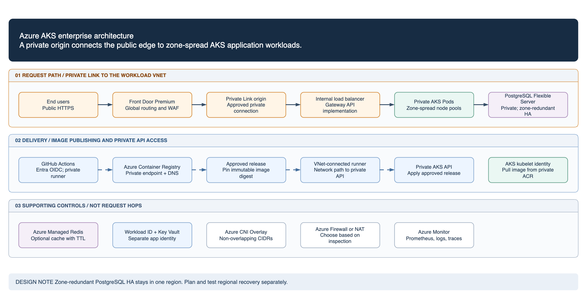

# Azure AKS Enterprise Architecture

Purpose: show private AKS ingress, zone-aware application capacity,
regional data services, and controlled deployment. The editable diagram is
[Azure-AKS-Enterprise.drawio](./Azure-AKS-Enterprise.drawio).

## Design notes

- Front Door uses an approved private-origin integration to reach internal
  ingress. Validate the exact Private Link origin and DNS configuration.
- Keep the AKS API private and use a network-connected runner for deployment.
  Entra OIDC authenticates the pipeline but does not create network access.
- Spread nodes across zones and use workload disruption protections. Zone
  redundancy protects against some zonal failures, not a full regional outage.
- PostgreSQL zone-redundant HA is regional. Define cross-Region backups or
  replicas separately if regional disaster recovery is required.
- Redis is a cache, not the system of record. Use TTLs and define behavior
  during cache loss or cold start.
- Monitor SNAT use and outbound routes. Choose Azure Firewall or NAT Gateway
  based on inspection, throughput, and operating requirements.
