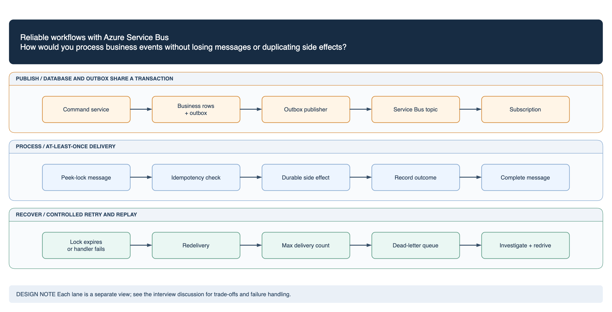

# Reliable workflows with Azure Service Bus

**Interview question:** How would you process business events without losing
messages or duplicating side effects?

[Editable diagram](./azure-service-bus-reliable-workflows.drawio)
Difficulty: Advanced

## Expert discussion

### Architecture

Commit business state and an outbox event atomically in the same database
transaction. A publisher sends committed events to a topic; subscriptions
isolate consumer delivery and retry behavior.

### Design considerations

Peek-lock and complete only after durable work succeeds. A crash after the
side effect but before completion causes redelivery, so use a stable event ID
and an idempotency record or idempotent downstream API. Renew locks for long-
running work and bound retries.

### Trade-offs and operations

Sessions can preserve ordering within a session key, not global ordering.
Broker duplicate detection has a configured time window and is not end-to-end
exactly-once processing.

### Validation

Monitor oldest message age, delivery count, lock losses, DLQ depth and
consumer lag. Provide a reviewed redrive procedure that preserves idempotency
and avoids poison-message loops.

## Interview follow-ups

**Q: What if a worker crashes after a side effect but before completion?**

The message may be delivered again. Atomically commit an idempotency record
with local database effects, or use a stable idempotency key at the downstream
service. Complete only after durable success.

**Q: Do sessions or duplicate detection provide exactly-once processing?**

No. Sessions order messages within a session key; broker duplicate detection
is limited to its configured window. Retries and downstream side effects still
require application-level safety.

## Sources

- <https://learn.microsoft.com/en-us/azure/service-bus-messaging/service-bus-message-loss-and-duplicates>
- <https://learn.microsoft.com/en-us/azure/architecture/databases/guide/transactional-out-box-cosmos>
