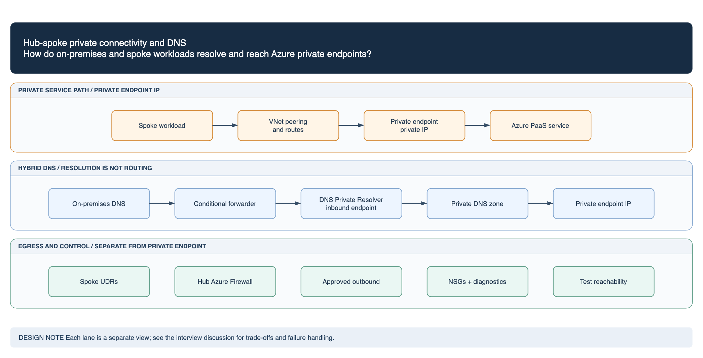

# Hub-spoke private connectivity and DNS

**Interview question:** How do on-premises and spoke workloads resolve and
reach Azure private endpoints?

[Editable diagram](./azure-hub-spoke-private-dns.drawio)
Difficulty: Advanced

## Expert discussion

### Architecture

Use VNet peering and appropriate routing to reach the private endpoint. Link
the private DNS zone to the relevant VNets or resolve through a linked
resolver VNet. DNS gives the correct IP; it does not create a network route or
grant access.

### Design considerations

For hybrid resolution, forward the relevant service namespace from on-premises
DNS to an Azure DNS Private Resolver inbound endpoint reachable over VPN or
ExpressRoute. Validate zone links, forwarding and regional availability for
the design.

### Trade-offs and operations

Outbound internet inspection through Azure Firewall is a separate route from
the private endpoint path. UDRs, private endpoint network policy options,
return routing and asymmetric paths must be deliberately tested; do not assume
every private endpoint flow traverses the firewall.

### Validation

Troubleshoot resolution from each origin, effective routes, NSGs, endpoint
approval, TLS hostnames and service authorization. Exercise DNS and
connectivity failures separately.

## Interview follow-ups

**Q: DNS resolves to a private IP but the application still times out. Why?**

DNS does not establish routing, security-group permission, endpoint approval
or return-path symmetry. Test each separately from the actual source network
and verify the service's TLS hostname.

**Q: Must all private endpoint traffic traverse Azure Firewall?**

No. Inspection requires a supported network design and explicit routes, policy
settings and symmetric return paths. Validate effective routes instead of
inferring inspection from a hub-and-spoke picture.

## Sources

- <https://learn.microsoft.com/en-us/azure/private-link/private-endpoint-dns-integration>
- <https://learn.microsoft.com/en-us/azure/dns/dns-private-resolver-overview>
