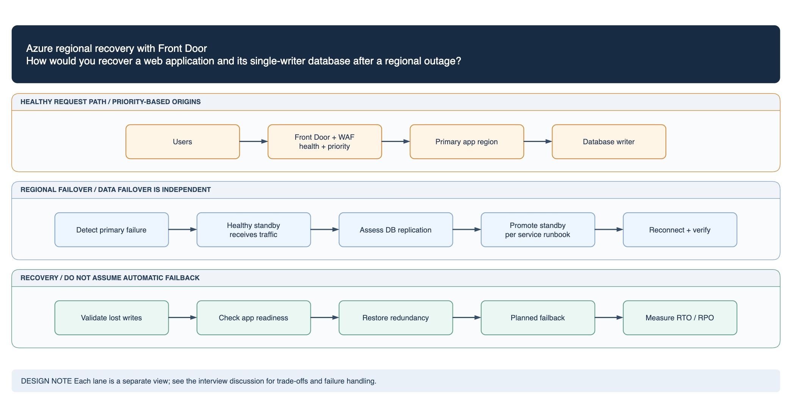

# Azure regional recovery with Front Door

**Interview question:** How would you recover a web application and its
single-writer database after a regional outage?

[Editable diagram](./azure-front-door-regional-recovery.drawio)
Difficulty: Advanced

## Expert discussion

### Architecture

Front Door evaluates origin health and priority to route traffic to a healthy
standby. A web origin switch does not promote a database or restore replicated
state; gate write readiness on the actual database recovery.

### Design considerations

For an asynchronous single-writer database, decide whether to accept writes
lost since the latest replicated position. Perform the database-specific
promotion and connection recovery; verify current SKU, regional support and
replica constraints.

### Trade-offs and operations

A liveness-only probe can route traffic to an app that cannot perform useful
work. Choose readiness semantics deliberately and handle the documented all-
origins-unhealthy behavior rather than assuming traffic stops.

### Validation

Measure probe and routing convergence, replication lag, writer promotion,
client retries and business reconciliation. Test partial failure and failback;
use idempotency to handle retries around the outage.

## Interview follow-ups

**Q: Does Front Door failover promote the database?**

No. Route only to an application that can meet its advertised readiness
contract. Promote the database separately, reconnect clients and reconcile
writes that did not replicate.

**Q: What if all origins fail health probes?**

Front Door has documented all-unhealthy routing behavior; do not assume it
stops all traffic. Exercise this case, use application degraded responses and
tune probe sensitivity against false failover.

## Sources

- <https://learn.microsoft.com/en-us/azure/frontdoor/routing-methods>
- <https://learn.microsoft.com/en-us/azure/frontdoor/health-probes>
