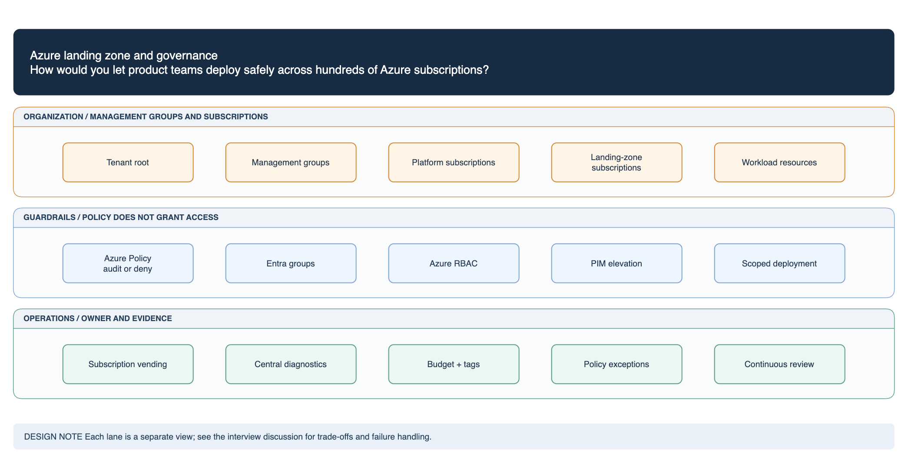

# Azure landing zone and governance

**Interview question:** How would you let product teams deploy safely across
hundreds of Azure subscriptions?

[Editable diagram](./azure-landing-zone-governance.drawio)
Difficulty: Advanced

## Expert discussion

### Architecture

Organize subscriptions beneath management groups according to ownership and
policy scope. Place connectivity, identity and management services in platform
subscriptions; give workloads separate subscriptions when isolation and
ownership justify it.

### Design considerations

Azure Policy evaluates and can deny or remediate specified configurations; it
does not grant access. Entra ID and Azure RBAC govern principals and roles;
use PIM and time-bound elevation where appropriate.

### Trade-offs and operations

Automate subscription vending with baseline networking, logging, security,
budgets and ownership. Make exception approval explicit and expiring; account
for resource-provider behavior and policy assignments at inherited scopes.

### Validation

Review effective role assignments, policy compliance, denied deployments,
diagnostic ingestion and cost. Test whether central logging and security
operations still work when a workload subscription is impaired.

## Interview follow-ups

**Q: Does a policy assignment grant the team access?**

No. Azure Policy evaluates or enforces configuration; Entra principals and
Azure RBAC grant access. Check inherited assignments, deny behavior,
exemptions and role scope independently.

**Q: How do you balance central governance and team autonomy?**

Automate a small mandatory baseline and self-service subscription vending;
assign clear owners and time-bound exceptions. Track deployment failures,
exemption age and onboarding time.

## Sources

- <https://learn.microsoft.com/en-us/azure/cloud-adoption-framework/ready/landing-zone/>
- <https://learn.microsoft.com/en-us/azure/governance/policy/overview>
